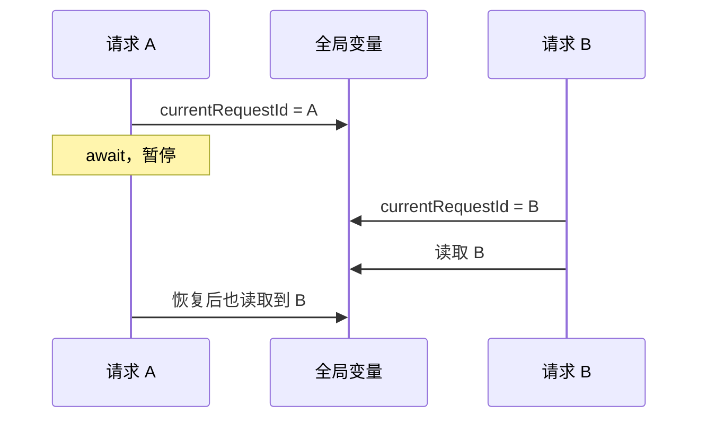
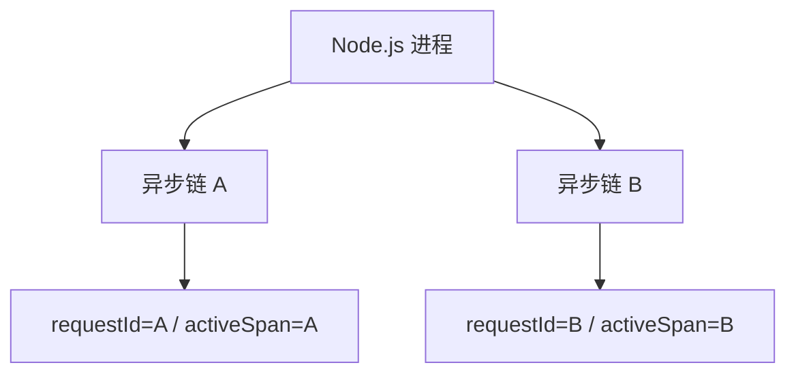
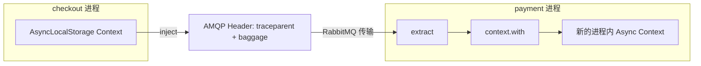

# Commit 3：异步 Trace Context 与 Baggage

## 相对 Commit 2 的改动

Commit 2 的业务消息能到达 payment-service，但可观测上下文在 RabbitMQ 处中断。本步使用 OpenTelemetry Propagator，将 checkout 当前上下文注入 AMQP Headers，并在 payment-service 消费时提取：

```text
checkout active context
  → inject
  → AMQP headers: traceparent + baggage
  → extract
  → payment active context
```

`traceparent` 携带 Trace ID、上游 Span ID 和采样标志；`baggage` 携带 `demo.cart.id`、`demo.tenant.id`。消息 JSON 仍只放订单业务数据，业务契约与传播协议互不混合。

消费端只接受上述两个 Baggage 键，并限制传播 Header 和字段长度、拒绝控制字符。消息 Header 属于外部输入，不能直接作为可信日志属性。

本步没有启用 amqplib 自动插桩，也没有创建 Producer/Consumer Span 或 Span Link。因此 payment 日志可以带原 Trace ID，但 Jaeger 中暂时没有 payment-service Span；这是 Commit 4 的内容。

## 为什么并发异步上下文不会串

进程内的 OpenTelemetry Context 依赖 Node.js 异步上下文隔离：每条 Promise、回调和 `async/await` 调用链都有自己的当前 Context。它解决的是“多个请求同时执行时，深层代码如何拿到正确的当前 Span”。

### 反例：用全局变量保存当前请求

```js
'use strict';

let currentRequestId;

// 模拟一条会暂停并恢复的异步请求。
async function handleRequest(requestId, delay) {
  currentRequestId = requestId;
  console.log('开始：', currentRequestId);
  await new Promise((resolve) => setTimeout(resolve, delay));
  console.log('结束：', currentRequestId);
}

Promise.all([
  handleRequest('request-A', 100),
  handleRequest('request-B', 20),
]);
```

可能输出：

```text
开始：request-A
开始：request-B
结束：request-B
结束：request-B
```

A 等待期间，B 覆盖了同一个全局变量；A 恢复执行时读到的是 B，这就是“上下文串了”。



### AsyncLocalStorage：每条异步链保存一份数据

```js
'use strict';

const { AsyncLocalStorage } = require('node:async_hooks');

const requestContext = new AsyncLocalStorage();

// 从当前异步调用链读取请求 ID。
function getCurrentRequestId() {
  return requestContext.getStore()?.requestId;
}

// 在独立上下文中运行一条异步请求。
async function handleRequest(requestId, delay) {
  return requestContext.run({ requestId }, async () => {
    console.log('开始：', getCurrentRequestId());
    await new Promise((resolve) => setTimeout(resolve, delay));
    console.log('结束：', getCurrentRequestId());
  });
}

Promise.all([
  handleRequest('request-A', 100),
  handleRequest('request-B', 20),
]);
```

此时输出为：

```text
开始：request-A
开始：request-B
结束：request-B
结束：request-A
```

可以把内存结构理解为：



### 对应到 OpenTelemetry Context API

OpenTelemetry 的 Node.js Context Manager 使用这种异步隔离机制保存当前 Context：

| OpenTelemetry API | 类似的 AsyncLocalStorage 操作 |
| --- | --- |
| `context.with(ctx, callback)` | `storage.run(ctx, callback)` |
| `context.active()` | `storage.getStore()` |
| `trace.getActiveSpan()` | 从当前 Store 读取 Active Span |
| `startActiveSpan()` | 创建 Span 并在回调期间激活它 |

因此并发请求的执行顺序可以交错，但 `trace.getActiveSpan()` 仍会读取各自的 Span：

```text
request-A → span-A → database-span-A
request-B → span-B → database-span-B
```

这个原理可在一个独立 Node.js 脚本中用终端输出或 Console Exporter 验证，不需要启动 checkout、inventory、payment 或 Collector。

### 为什么 RabbitMQ 仍然需要 traceparent

`AsyncLocalStorage` 只能隔离同一个 Node.js 进程中的异步调用，不能跨进程、网络或消息队列传递内存：



所以两类传播需要配合：

```text
同一进程内：AsyncLocalStorage / Context Manager 隔离并发调用链
跨进程之间：inject → traceparent → extract 传递链路身份
```

可以记成一句话：**进程内靠 Context 隔离，进程间靠 Header 接力。**

## 关键词解释

### `propagation` 与全局 Propagator

`propagation` 是 OpenTelemetry 的上下文传播 API，负责将当前 Context 注入 HTTP Header、AMQP Header 等载体，以及从收到的载体中提取 Context。以下配置为应用注册一个全局传播器：

```js
propagation.setGlobalPropagator(new CompositePropagator({
  propagators: [new W3CTraceContextPropagator(), new W3CBaggagePropagator()],
}));
```

各组件的作用如下：

- `setGlobalPropagator(...)` 指定全局使用的传播规则；后续的 `propagation.inject()` 和 `propagation.extract()` 都会使用它。
- `CompositePropagator` 将多种传播器组合成一个传播器。
- `W3CTraceContextPropagator` 负责 `traceparent` 和可选的 `tracestate`，传播 Trace ID、上游 Span ID 和采样标志。
- `W3CBaggagePropagator` 负责 `baggage`，传播少量业务诊断上下文。

它只定义“上下文如何编码和解析”，不会自动完成传输，也不会自动创建 Span。真正跨进程传播时，还需要 HTTP/AMQP 自动插桩，或由代码显式调用 `inject()` 和 `extract()`：

```text
发送方当前 Context
  → inject
  → HTTP Header / AMQP Header: traceparent + baggage
  → extract
  → 接收方 Context
```

### `traceparent`

`traceparent` 是 W3C Trace Context 定义的标准传播字段，用于告诉消息消费者“这条消息属于哪条 Trace，上游 Span 是谁”。典型格式如下：

```text
00-e8029ba14cbee40e1f6c177771325845-6df49bd4c4b8dfa1-01
│  │                                │                └─ Trace Flags：01 表示采样
│  │                                └─ 上游 Span ID：16 个十六进制字符
│  └─ Trace ID：32 个十六进制字符
└─ 协议版本
```

Producer 将当前上下文注入消息 Header，Consumer 提取后创建的新 Span 才能继承相同 Trace ID。`traceparent` 只传播链路身份和采样决定，本身不会创建 Span，也不包含订单、用户等业务信息。

### `baggage`

`baggage` 是 W3C Baggage 定义的键值传播字段，用于让少量诊断上下文随请求或消息跨服务传递：

```text
baggage: demo.cart.id=cart-001,demo.tenant.id=demo-shop
```

Baggage 不会自动成为 Span 或 Log Attribute；Consumer 需要读取并按需复制。它不能代替正式业务参数，也不能作为可信的鉴权来源，因为调用方可以修改消息 Header。不要放密码、Token、个人敏感信息或大量字段。

两者的区别可以记为：

```text
traceparent → 传播“链路是谁”
baggage     → 传播“随链路携带的少量上下文”
```

## 手工验证：看见上下文穿过 RabbitMQ

### 1. 只启动 HTTP 服务

```bash
npm run infra:up
npm start
```

确认旧的 `rabbitmq:consumer` 和 `start:payment` 都已停止。在 <http://localhost:15672> 使用 `otel` / `otel-demo` 登录，并清空 `otel.demo.orders` 中的演示消息。

### 2. 创建一条必定保留的慢请求

```bash
curl -s 'http://localhost:3000/checkout?slow=true'
```

复制响应中的 `orderId` 和 32 位 `observability.traceId`。使用慢请求是为了让 Collector 尾采样 100% 保留该 Trace。

### 3. 在 RabbitMQ 查看 Headers

进入 **Queues and Streams → `otel.demo.orders` → Get messages**：

- Ack Mode：`Nack message requeue true`
- Messages：`1`
- 点击 **Get Message(s)**

不要选择 Ack，否则消息会被移除。展开 Properties，应看到类似：

```text
traceparent: 00-TRACE_ID-PARENT_SPAN_ID-01
baggage: demo.cart.id=cart-...,demo.tenant.id=demo-shop
```

`traceparent` 中第二段必须与 checkout 响应的 Trace ID 完全相同。Payload 的 `orderId` 也应与响应一致。

### 4. 启动 payment-service 并核对提取结果

```bash
npm run start:payment
```

终端应打印：

```text
payment-service 恢复消息上下文：trace_id=TRACE_ID cart_id=cart-... tenant_id=demo-shop
payment-service 开始处理订单：order-...
payment-service 已 ACK：order-...
```

这里的 Trace ID 必须与 checkout 响应及 RabbitMQ `traceparent` 一致。

### 5. 在 Loki 查询跨异步服务日志

打开 checkout 响应中的 `grafanaLogs` 链接，或在 Grafana Explore 选择 Loki：

```logql
{service_name=~"checkout-service|inventory-service|payment-service"} |= "TRACE_ID"
```

只看支付日志：

```logql
{service_name="payment-service"} |= "TRACE_ID"
```

支付日志应包含 `异步支付完成`、相同 Trace ID、`demo.cart.id` 和 `demo.tenant.id`。

### 6. 理解 Jaeger 中“缺失”的部分

在 Jaeger 打开该 Trace：checkout 和 inventory Span 正常存在，但看不到 payment-service。上下文传播只把身份带过去，不会自动产生新 Span。payment 日志使用的 `span_id` 仍是消息发送时的上游 Span ID。Commit 4 将创建真正的 Producer/Consumer Span，并展示异步处理节点。

## 常见问题

- Header 中没有 `traceparent`：checkout 未通过 `instrumentation.js` 启动，或查看的是 Commit 1 命令行 Producer 产生的消息。
- payment 显示 `trace_id=无`：消息来自旧版本/手工 Producer，或者 payment 没用 `npm run start:payment` 启动。
- Loki 暂时搜不到：日志是批量导出的，等待约 3–5 秒并扩大到最近 15 分钟。
- Jaeger 看不到 payment-service：本步预期如此，不代表传播失败。

## 学习点

- Trace Context 是传播数据，不等于 Span。
- Baggage 适合传播少量业务上下文，但不应放密码、Token 或无限基数数据。
- `context.with(extractedContext, ...)` 保证异步处理和日志读取的是消息携带的上下文。
- HTTP Header 与 AMQP Header 使用不同载体，但都可通过同一 OTel Propagator 注入和提取。
